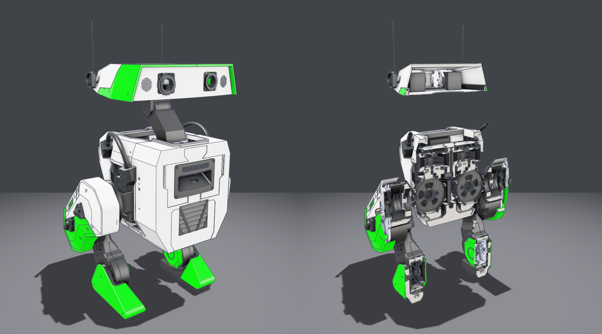
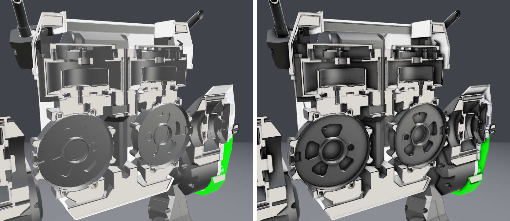
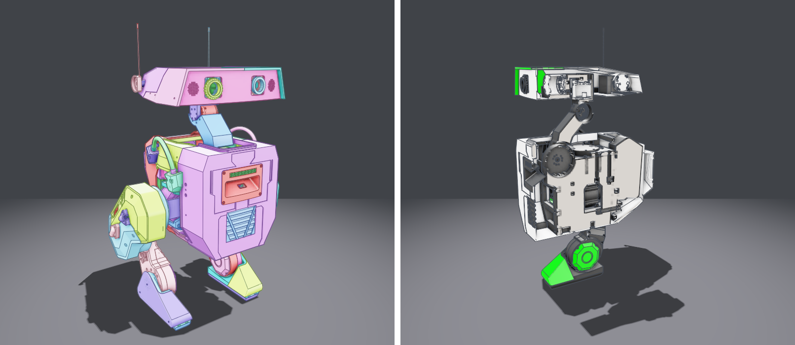

# stpview

A CAD rendering library and viewer for STEP (ISO 10303-21) B-rep models, in
Rust. It parses STEP itself, tessellates the exact B-rep surfaces, and draws
them with wgpu -- no OpenCascade, no other CAD kernel. It opens STL meshes too.



The [BDX-R](https://github.com/BDX-R/BDX-R-CAD) open-source biped (MIT), whole
and with `--section x`: a 92 MB STEP file of 1.17M entities, 119 solids and
20,256 faces, read and tessellated into 1.06M triangles in under two seconds.



Screen-space ambient occlusion, off and on (`--ao off`, `--ao heavy`): without
it the gear pockets read as flat discs, with it they have depth.



Parts coloured by their assembly (`--colors assembly`, or `C` in the viewer),
and a capped section through the neck and leg drives (`--section y`).

| Crate | Role |
| --- | --- |
| `stpview-core` | Parser, B-rep model, geometry, tessellation, STL reader, `Assets` cache, `Scene`. No GPU. |
| `stpview` | The renderer: image-based lighting, SSAO, section capping, edges, picking, GPU instancing. Headless or on your own `wgpu` surface. |
| `stpview-app` | The `stpview` CLI and interactive viewer, built on the public API only. |
| `stpview-shell` | A Windows Explorer thumbnail provider, built on the same API. |

## The viewer

```bash
cargo run --release -p stpview-app -- "path/to/model.step"
```

The window opens straight away and the model streams in as it is tessellated.
When the vi>ew is still, close-up parts are tessellated again at screen
resolution. An `.stl` opens the same way, already triangles; see
[STL](#stl).

| Input | Action |
| --- | --- |
| left drag | orbit |
| right / middle drag, shift + left drag | pan |
| wheel | zoom |
| click / ctrl + click | select a part / add or remove one |
| `Up` / `Down` | widen the selection to its assembly / narrow it back |
| `Esc` | select nothing |
| `H` / `I` / `A` | hide / isolate / show all |
| `C` | colours: file -> by part -> by assembly |
| `F` | fit the view |
| `E` | edges: sharp -> all -> off |
| `S` | toggle shaded surfaces |
| `O` | ambient occlusion level |
| `X` / `Y` / `Z` | section on that axis; `[` / `]` slides the plane, `K` fills the cut |
| `G` / `L` | ground plane / silhouette outline |
| `Q` | quit |

A 3Dconnexion SpaceMouse works too, over raw HID with no SDK. `stpview --puck`
prints its axes.

## Command line

```bash
stpview model.step --stats --check                 # statistics and watertightness, no window
stpview model.step --shot out.png --view 30,20     # render one frame to a PNG
stpview model.step --section -z                    # cut the model and fill the cut
stpview model.step --tree                          # assembly tree with triangle counts
stpview model.step --only "Bracket" --shot b.png   # draw only matching parts
stpview models/composite.toml --shot scene.png     # a composed scene
```

`stpview --help` lists every option. The ones you will reach for most:

| Option | |
| --- | --- |
| `--tol <mm>` | chord tolerance (default: 0.03% of the bounding box) |
| `--view yaw,pitch[,x,y,z[,radius]]` | aim the camera, for a shot or as the viewer opens |
| `--size <WxH>` | frame size for `--shot` (default 1200x900) |
| `--edges sharp\|all\|off`, `--wire`, `--ao <level>` | what is drawn |
| `--no-ground`, `--no-silhouette`, `--no-cap` | leave things out |
| `--colors part\|assembly`, `--select x,y` | paint parts, as `C` and a click do |
| `--supersample <n>`, `--no-refine` | turn off the still-view averaging or the re-tessellation |

## The library

```rust
use stpview::{Assets, Camera, RenderOptions, Renderer, Scene};
use stpview::geom::Xform;

let assets = Assets::new();
let board  = assets.import("board.step")?;
let header = assets.import("pin_header.step")?;  // imported once, however often placed

let mut scene = Scene::new();                    // world space is millimetres
scene.add(board, Xform::IDENTITY);
for p in placements {
    scene.add(header.clone(), Xform::translate(p));
}

let mut r = Renderer::offscreen_scene(1600, 1200, &scene)?;
let rgba = r.capture(&Camera::new(&scene.bounds()), &RenderOptions::default())?;
```

Two examples run it end to end:

```bash
cargo run --release -p stpview --example pcb -- <dir-with-step-files>
cargo run --release -p stpview --example contact -- <dir> <out-dir>
```

Scenes can also be written as TOML: a list of `[[place]]` blocks with `file`,
`at` (mm), `rotate` (degrees), `scale` and `tint`. See
[models/composite.toml](models/composite.toml). Each model's units are applied
automatically, so an inch part sits at true size beside metric ones.

## Explorer thumbnails (Windows)

```bash
stpview --register      # and --unregister
```

This makes Explorer draw thumbnails of `.step`, `.stp` and `.stl` files, and
gives the STEP ones their own icon. Everything goes under `HKCU`, so no
administrator is needed. An extension another provider already draws for this
user is left to it, and named. Two things can make it look broken:

- Explorer caches thumbnails, so check a folder it has not seen before.
- `dllhost.exe` keeps the DLL open, so a rebuild fails until that process exits.

`stpview model.step --thumb t.png` renders the same picture from the command
line. Set `STPVIEW_THUMB_LOG=<file>` with `setx` to log failures from inside
the shell. Files over 64 MB are skipped (`STPVIEW_THUMB_MAX_MB` changes that).

## Supported STEP

- **Surfaces:** plane, cylinder, cone, sphere, torus (including degenerate),
  B-spline (rational, uniform, quasi-uniform, Bezier), surface of revolution,
  linear extrusion, rectangular trimmed.
- **Curves:** line, circle, ellipse, B-spline (rational, uniform, quasi-uniform,
  Bezier), trimmed curve, `SURFACE_CURVE` / `INTERSECTION_CURVE` / `SEAM_CURVE`.
- **Topology:** advanced and faceted B-reps, B-reps with voids, open and closed
  shells, shell-based surface models, `POLY_LOOP`, `VERTEX_LOOP`, and
  geometrically bounded surfaces and loose curves in a `GEOMETRIC_SET`.
- **Assemblies:** `MAPPED_ITEM` and `CONTEXT_DEPENDENT_SHAPE_REPRESENTATION`,
  with product names for the tree.
- **Appearance:** colour and transparency per solid or per face.
- **Units:** length and plane-angle units from the file. Abbreviated entity
  names (`CRTPNT`, `FCSRF`, ...) are expanded.

Not supported: `OFFSET_SURFACE`. Unsupported entities and dropped faces are
counted and named by `--stats`.

## STL

Binary and ASCII, told apart by the file's length rather than its first word.
Each ASCII `solid` is a part. An STL has no units, so it is read as
millimetres; `--tol` does not apply, since the facets are the tessellation.

- **Shading:** identical corners are welded, and normals are smoothed across
  facets meeting at under 40 degrees. The normals written in the file are
  checked against the winding and otherwise ignored.
- **Edges:** creases past 40 degrees, plus open and non-manifold edges. On a
  rough surface (a scan, a sculpt, displaced terrain) the creases are texture,
  so they are left to `--edges all`. A surface counts as rough when under a
  tenth of its neighbouring facets are coplanar.
- **Colour:** per facet in the VisCAM/SolidView convention, and per solid
  plus per facet in Materialise Magics' (`COLOR=` in the header).
- **Sectioning:** a solid is capped when every edge has two facets wound
  consistently.

`--stats` reports what the welding found: open, flipped and over-shared
edges, degenerate facets, and written normals that disagree with the winding.

## Tests

```bash
cargo test --release                  # unit tests across the workspace
powershell -File models/fetch.ps1     # download the sample corpus (not committed)
powershell -File models/baseline.ps1  # corpus statistics against models/baseline.tsv
powershell -File models/visual.ps1    # stored views, compared pixel for pixel
```

See [models/README.md](models/README.md) for the corpus and
[CONTRIBUTING.md](CONTRIBUTING.md) for conventions and debug switches.

## License

GPL-3.0-or-later. See [LICENSE](LICENSE).
